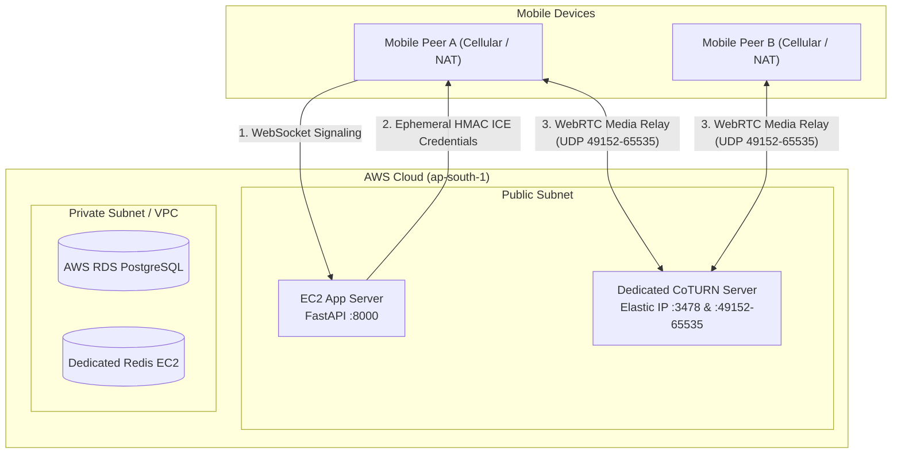

# AWS Standalone CoTURN Server Setup Guide (Service 3 — WebRTC Media Relay)

> **Objective:** Deploy, configure, and verify a dedicated, standalone **CoTURN (STUN/TURN) EC2 instance** with an Elastic IP on AWS Free Tier (`t3.micro`). This isolates all heavy WebRTC UDP video/audio relay traffic from the FastAPI application and database, resolving peer-to-peer connection hangs across NAT/cellular firewalls.

---

## 📋 Architecture Overview



---

## 🛠️ Step-by-Step Implementation

### Step 1: Create the CoTURN Security Group (`langmatcher-coturn-sg`)

WebRTC requires distinct ports for initial STUN discovery, TURN signaling over UDP/TCP, and a large dynamic UDP port range for relayed media streams.

1. In the **AWS Management Console**, navigate to **EC2 $\to$ Network & Security $\to$ Security Groups**.
2. Click **Create security group**.
3. **Basic Details**:
   - **Security group name**: `langmatcher-coturn-sg`
   - **Description**: `Allow WebRTC STUN/TURN and dynamic media relay traffic`
   - **VPC**: Select your default VPC (`vpc-0f93db732cca6d773`)
4. **Inbound Rules** (Add the following 5 rules):
   | Type | Protocol | Port Range | Source | Description |
   | :--- | :--- | :--- | :--- | :--- |
   | **SSH** | TCP | `22` | `My IP` | Terminal administration |
   | **Custom UDP** | UDP | `3478` | `0.0.0.0/0` (Anywhere-IPv4) | STUN/TURN UDP signaling |
   | **Custom TCP** | TCP | `3478` | `0.0.0.0/0` (Anywhere-IPv4) | TURN TCP signaling fallback |
   | **Custom TCP** | TCP | `5349` | `0.0.0.0/0` (Anywhere-IPv4) | TURNS (TLS) signaling |
   | **Custom UDP** | UDP | `49152 - 65535` | `0.0.0.0/0` (Anywhere-IPv4) | WebRTC audio/video relay port range |

   > [!IMPORTANT]
   > The UDP port range **`49152 - 65535`** carries the actual real-time audio and video frames. If this rule is missing, callers will connect successfully on signaling but the call will freeze or stay on a black screen.

5. **Outbound Rules**: Keep default (`All traffic`, `0.0.0.0/0`).
6. Click **Create security group**.

---

### Step 2: Allocate an Elastic IP for CoTURN

CoTURN advertises its public IP address (`external-ip`) inside ICE candidate messages sent to mobile peers. If your instance restarts and receives a new dynamic IP, all media relays will fail. An Elastic IP prevents this.

1. Navigate to **EC2 $\to$ Network & Security $\to$ Elastic IPs**.
2. Click **Allocate Elastic IP address**.
3. Set **Network border group** to your region (`ap-south-1`) and click **Allocate**.
4. Note the allocated IPv4 address (e.g. `13.235.X.X`). We will refer to this as `<COTURN_ELASTIC_IP>`.

---

### Step 3: Launch the CoTURN EC2 Instance

1. Navigate to **EC2 $\to$ Instances $\to$ Launch instances**.
2. **Name**: `langmatcher-coturn`
3. **Application and OS Images**:
   - **OS**: **Ubuntu**
   - **AMI**: **Ubuntu Server 22.04 LTS (HVM), SSD Volume Type** (Free tier eligible)
4. **Instance Type**: `t3.micro` (Free tier eligible).
5. **Key Pair**: Select your existing key pair (`langmatcher-key.pem`).
6. **Network Settings** $\to$ click **Edit**:
   - **VPC**: Default VPC
   - **Subnet**: No preference (or public subnet)
   - **Auto-assign public IP**: **Enable**
   - **Firewall (security groups)**: Choose **Select existing security group** $\to$ choose **`langmatcher-coturn-sg`** (uncheck `default`).
7. **Configure Storage**: Default `8 GiB gp3`.
8. Click **Launch instance**.

---

### Step 4: Associate the Elastic IP to the Instance

1. Once the instance status changes to **Running**, go to **EC2 $\to$ Elastic IPs**.
2. Select your newly allocated Elastic IP from Step 2.
3. Click **Actions $\to$ Associate Elastic IP address**.
4. Set **Resource type** to **Instance**.
5. In **Instance**, select `langmatcher-coturn`.
6. Click **Associate**.

---

### Step 5: Install CoTURN on the EC2 Instance

1. Open PowerShell or a terminal on your computer and connect to the CoTURN instance:
   ```powershell
   ssh -i "C:\V33R\Programming\College\Sem_7\Project\language-partner-matcher\langmatcher-key.pem" ubuntu@<COTURN_ELASTIC_IP>
   ```

2. Update the apt index and install the `coturn` package:
   ```bash
   sudo apt update && sudo apt install -y coturn
   ```

3. Enable the system daemon by uncommenting `TURNSERVER_ENABLED=1`:
   ```bash
   sudo sed -i 's/#TURNSERVER_ENABLED=1/TURNSERVER_ENABLED=1/' /etc/default/coturn
   ```

---

### Step 6: Configure `/etc/turnserver.conf`

1. Move the default verbose template to a backup file:
   ```bash
   sudo mv /etc/turnserver.conf /etc/turnserver.conf.backup
   ```

2. Create the production configuration file:
   ```bash
   sudo nano /etc/turnserver.conf
   ```

3. Paste the following configuration (replace `<COTURN_ELASTIC_IP>` with your actual Elastic IP):

   ```ini
   # ================================================================
   # CoTURN WebRTC Production Configuration - Language Partner Matcher
   # ================================================================

   # Standard WebRTC STUN/TURN Listening Ports
   listening-port=3478
   tls-listening-port=5349

   # Public IP advertised to WebRTC peers
   external-ip=<COTURN_ELASTIC_IP>

   # Dynamic UDP Relay Port Range for Audio/Video Streams
   min-port=49152
   max-port=65535

   # Ephemeral HMAC-SHA1 Authentication Credentials
   fingerprint
   lt-cred-mech
   use-auth-secret
   static-auth-secret=coturn_production_shared_secret_789xyz
   realm=langmatcher.com

   # Session and Security Hardening
   no-cli
   no-tls
   no-dtls
   stale-nonce=600

   # Logging
   verbose
   syslog
   ```

   *(To save in `nano`: press `Ctrl + O`, then `Enter`, then `Ctrl + X`)*.

---

### Step 7: Start and Enable the CoTURN Service

1. Restart and enable the CoTURN service:
   ```bash
   sudo systemctl restart coturn
   sudo systemctl enable coturn
   ```

2. Verify service status:
   ```bash
   sudo systemctl status coturn
   ```
   *(Ensure it reports `Active: active (running)`. Press `q` to exit)*.

3. Verify that the process is actively listening on UDP port 3478:
   ```bash
   sudo ss -ulpn | grep turn
   ```
   **Expected output**:
   ```text
   UNCONN 0 0 0.0.0.0:3478 0.0.0.0:* users:(("turnserver",pid=...,fd=...))
   ```

---

### Step 8: Update the App Server Configuration

Connect your FastAPI backend to this standalone CoTURN server so it issues valid HMAC credentials to mobile clients.

1. SSH into your **App Server**:
   ```powershell
   ssh -i "C:\V33R\Programming\College\Sem_7\Project\language-partner-matcher\langmatcher-key.pem" ubuntu@13.235.12.217
   ```

2. Edit your backend `.env` file:
   ```bash
   nano ~/test/language-partner-matcher/backend/.env
   ```

3. Update the TURN variables with your CoTURN Elastic IP and secret:
   ```ini
   # Standalone CoTURN Server Configuration
   TURN_DOMAIN=<COTURN_ELASTIC_IP>
   TURN_SERVER_IP=<COTURN_ELASTIC_IP>
   TURN_SHARED_SECRET=coturn_production_shared_secret_789xyz
   TURN_PORT_UDP=3478
   TURN_PORT_TLS=5349
   ```

4. Restart your decoupled backend container:
   ```bash
   cd ~/test/language-partner-matcher/backend
   docker compose -f docker-compose.decoupled.yml restart
   ```

---

## 🔍 Verification & Health Checks

### Test 1: Check FastAPI ICE Server Endpoint
From your App Server (or local computer using public IP), run:
```bash
curl http://localhost:8000/api/v1/webrtc/ice-servers
```

**Expected JSON Response:**
```json
{
  "iceServers": [
    {
      "urls": [
        "stun:stun.l.google.com:19302",
        "stun:stun1.l.google.com:19302",
        "stun:stun2.l.google.com:19302",
        "stun:global.stun.twilio.com:3478"
      ]
    },
    {
      "urls": ["turn:<COTURN_ELASTIC_IP>:3478?transport=udp"],
      "username": "1729243456:guest",
      "credential": "generated_hmac_base64_string="
    },
    {
      "urls": ["turn:<COTURN_ELASTIC_IP>:3478?transport=tcp"],
      "username": "1729243456:guest",
      "credential": "generated_hmac_base64_string="
    },
    {
      "urls": ["turns:<COTURN_ELASTIC_IP>:5349?transport=tcp"],
      "username": "1729243456:guest",
      "credential": "generated_hmac_base64_string="
    }
  ],
  "expiresAt": 1729243456
}
```

### Test 2: WebRTC Trickle ICE Validator (Browser Test)
1. Open the [WebRTC Trickle ICE Tool](https://webrtc.github.io/samples/src/content/peerconnection/trickle-ice/).
2. Under **STUN or TURN URI**, enter:
   ```text
   turn:<COTURN_ELASTIC_IP>:3478?transport=udp
   ```
3. Copy the ephemeral `username` and `credential` from Test 1.
4. Click **Add Server**, then click **Gather candidates**.
5. Look at the candidate table:
   - When a row appears with **Component: `1`**, **Type: `relay`**, and **Address: `<COTURN_ELASTIC_IP>`**, your TURN relay is functioning and traversing NAT successfully!

---

## 🛡️ Troubleshooting

| Issue | Root Cause | Solution |
| :--- | :--- | :--- |
| **`relay` candidate generation fails or times out** | Security group blocking UDP port range `49152-65535` or port `3478`. | In AWS Console, check `langmatcher-coturn-sg` inbound rules to verify UDP `3478` and UDP `49152-65535` are allowed from `0.0.0.0/0`. |
| **`401 Unauthorized` in turnserver logs** | Secret mismatch between FastAPI backend and `/etc/turnserver.conf`. | Verify `static-auth-secret` in `/etc/turnserver.conf` matches `TURN_SHARED_SECRET` in backend `.env`. |
| **CoTURN service fails to start** | `TURNSERVER_ENABLED=1` not set in `/etc/default/coturn`. | Run `sudo sed -i 's/#TURNSERVER_ENABLED=1/TURNSERVER_ENABLED=1/' /etc/default/coturn` and restart. |
| **Video call stays on black screen** | NAT hairpinning or wrong `external-ip`. | Ensure `external-ip` in `/etc/turnserver.conf` matches your Elastic IP exactly. |
